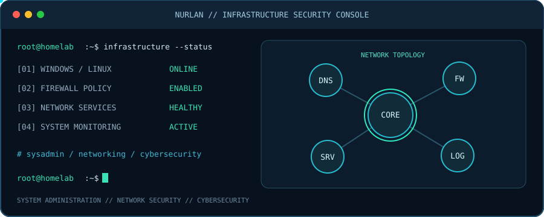

  

 # 🌐 IT System Integrator  
### Networks • Servers • Infrastructure
---

## 💫 About Me

🌐 **Junior IT System Integrator** with a strong focus on **Networks & Servers**.  
My primary interest lies in **IT infrastructure** — designing, building, and maintaining **stable, secure, and scalable systems**.

I enjoy working close to the system level:  
understanding how services communicate, how networks are structured, and how infrastructure behaves under **real-world conditions**.

---

## 🧩 Core Skills (Infrastructure Focus)

| 🖥️ Servers & Systems | 🌐 Networking |
|---------------------|---------------|
| Linux & Windows Server administration    User, group & permission management    Service configuration & troubleshooting    Virtualization basics    Monitoring & backups | TCP/IP & OSI model    DNS, DHCP    VLANs & subnetting    Static & dynamic routing    Network troubleshooting    CCNA-oriented knowledge |

---

## 🧠 Mindset

- Infrastructure-first thinking  
- Hands-on problem solving  
- Learning by building, breaking, and fixing systems  
- Focus on **stability, security, and reliability**

---

## 🌱 Currently Learning & Improving

- Advanced networking concepts (**CCNA level**)  
- Deeper Linux server internals  
- Infrastructure automation  
- Secure and resilient system design  

---

## 💻 Tech Stack

