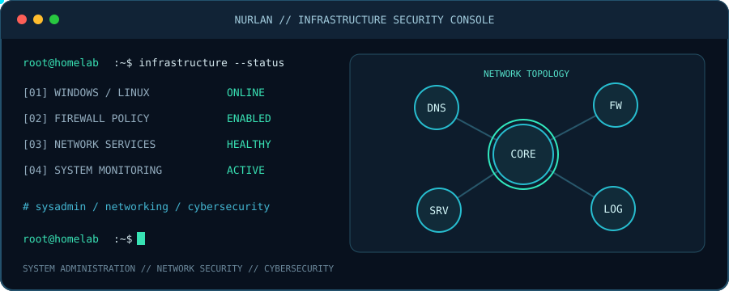

<div align="center">

# NURLAN BAKENBAEV
### SYSTEM ADMINISTRATION · NETWORK ENGINEERING · CYBERSECURITY

**Junior IT System Integrator | Infrastructure-focused | Security-minded**




</div>

<!DOCTYPE html>
<html lang="ru">
<head>
  <meta charset="UTF-8">
  <meta name="viewport" content="width=device-width, initial-scale=1.0">
  <title>3D SysAdmin Tech Sphere</title>
  <style>
    body {
      margin: 0;
      height: 100vh;
      display: flex;
      justify-content: center;
      align-items: center;
      background: radial-gradient(circle at center, #162a40 0%, #0b131e 65%, #070c14 100%);
      overflow: hidden;
      font-family: sans-serif;
    }
    #sphere-canvas {
      cursor: grab;
    }
    #sphere-canvas:active {
      cursor: grabbing;
    }
  </style>
</head>
<body>
  <canvas id="sphere-canvas" width="600" height="600"></canvas>

  <script>
    // Точный набор иконок со скриншота (Simple Icons CDN с оригинальными цветами)
    const iconsConfig = [
      { slug: 'linux', color: 'FCC624' },
      { slug: 'windows', color: '0078D6' },
      { slug: 'cisco', color: '1BA0D7' },
      { slug: 'docker', color: '2496ED' },
      { slug: 'kubernetes', color: '326CE5' },
      { slug: 'debian', color: 'A81D33' },
      { slug: 'ubuntu', color: 'E95420' },
      { slug: 'redhat', color: 'EE0000' },
      { slug: 'ansible', color: 'EE0000' },
      { slug: 'terraform', color: '844FBA' },
      { slug: 'git', color: 'F05032' },
      { slug: 'prometheus', color: 'E6522C' },
      { slug: 'grafana', color: 'F46800' },
      { slug: 'nginx', color: '009639' },
      { slug: 'apache', color: 'D22128' },
      { slug: 'openstack', color: 'ED1944' },
      { slug: 'vmware', color: '607078' },
      { slug: 'postgresql', color: '4169E1' },
      { slug: 'mysql', color: '4479A1' },
      { slug: 'python', color: '3776AB' },
      { slug: 'gnubash', color: '4EAA25' },
      { slug: 'microsoftazure', color: '0078D4' },
      { slug: 'ibm', color: '054ADA' }
    ];

    const canvas = document.getElementById('sphere-canvas');
    const ctx = canvas.getContext('2d');
    const radius = 210;
    const iconSize = 44;

    // Распределение точек по сфере методом Фибоначчи (Fibonacci Sphere)
    const nodes = iconsConfig.map((item, i) => {
      const phi = Math.acos(1 - 2 * (i + 0.5) / iconsConfig.length);
      const theta = Math.PI * (1 + Math.sqrt(5)) * i;

      const img = new Image();
      img.crossOrigin = "anonymous";
      img.src = `https://cdn.simpleicons.org/${item.slug}/${item.color}`;

      return {
        x: radius * Math.sin(phi) * Math.cos(theta),
        y: radius * Math.sin(phi) * Math.sin(theta),
        z: radius * Math.cos(phi),
        img: img,
        color: '#' + item.color
      };
    });

    let angleX = 0.003;
    let angleY = 0.004;

    // Реакция на движение мыши
    canvas.addEventListener('mousemove', (e) => {
      const rect = canvas.getBoundingClientRect();
      const mouseX = e.clientX - rect.left - canvas.width / 2;
      const mouseY = e.clientY - rect.top - canvas.height / 2;
      angleY = mouseX * 0.00004;
      angleX = -mouseY * 0.00004;
    });

    function rotateX(node, angle) {
      const cos = Math.cos(angle);
      const sin = Math.sin(angle);
      const y = node.y * cos - node.z * sin;
      const z = node.z * cos + node.y * sin;
      node.y = y;
      node.z = z;
    }

    function rotateY(node, angle) {
      const cos = Math.cos(angle);
      const sin = Math.sin(angle);
      const x = node.x * cos + node.z * sin;
      const z = node.z * cos - node.x * sin;
      node.x = x;
      node.z = z;
    }

    function render() {
      ctx.clearRect(0, 0, canvas.width, canvas.height);

      // Сортируем по глубине Z (дальние рисуются первыми)
      nodes.sort((a, b) => a.z - b.z);

      for (const node of nodes) {
        rotateX(node, angleX);
        rotateY(node, angleY);

        const scale = (node.z + radius * 2) / (radius * 2.5);
        const alpha = Math.max(0.18, Math.min(1, (node.z + radius) / (radius * 1.6)));

        const screenX = canvas.width / 2 + node.x * scale;
        const screenY = canvas.height / 2 + node.y * scale;
        const size = iconSize * scale;

        if (node.img.complete && node.img.naturalWidth > 0) {
          ctx.save();
          ctx.globalAlpha = alpha;
          ctx.shadowColor = node.color;
          ctx.shadowBlur = 12 * scale;
          ctx.drawImage(node.img, screenX - size / 2, screenY - size / 2, size, size);
          ctx.restore();
        }
      }
      requestAnimationFrame(render);
    }

    render();
  </script>
</body>
</html>
---

## `whoami`

I'm a **Junior IT System Integrator** focused on the systems that keep organizations connected, productive, and secure.

My interests sit at the intersection of **server administration, network infrastructure, and defensive security**. I enjoy understanding what happens beneath the interface: how DNS resolves requests, how traffic moves between subnets, how access is controlled, and why services fail.

I approach infrastructure with a simple principle:

> **Build it carefully. Secure it deliberately. Monitor it continuously. Understand it deeply.**

I learn through hands-on configuration, troubleshooting, and practical experimentation—turning technical theory into systems I can explain, maintain, and improve.

## `/areas-of-focus`

<table>
<tr>
<td width="33%" valign="top">

### 🖥️ Systems Administration
- Windows Server & Linux
- Users, groups & permissions
- Services and system troubleshooting
- Virtualization fundamentals
- Backups, updates & monitoring

</td>
<td width="33%" valign="top">

### 🌐 Network Engineering
- TCP/IP, OSI & subnetting
- DNS, DHCP & VLANs
- Switching & routing fundamentals
- Connectivity diagnostics
- CCNA-oriented networking study

</td>
<td width="33%" valign="top">

### 🛡️ Cybersecurity
- Defensive security fundamentals
- System hardening concepts
- Least privilege & access control
- Firewall policy fundamentals
- Logging, visibility & incident analysis

</td>
</tr>
</table>

## `toolbox --list`

**Operating systems & infrastructure**


**Networking & security**


**Scripting & development**


<sub>Technologies listed reflect areas of familiarity, practice, or ongoing study—not claims of certification or expert-level proficiency.</sub>

## `learning-path --current`

| Area | What I'm working toward |
| :--- | :--- |
| **Network engineering** | Stronger routing, switching, subnetting, and network analysis skills |
| **Linux administration** | Deeper service management, permissions, automation, and troubleshooting |
| **Windows infrastructure** | Better understanding of directory services, identity, policy, and server operations |
| **Blue-team security** | Hardening, log analysis, monitoring, and incident-response fundamentals |
| **Automation** | Repeatable administration with PowerShell, Bash, and version control |

## `engineering-mindset`

```text
OBSERVE  ->  DIAGNOSE  ->  FIX  ->  VERIFY  ->  DOCUMENT
   |            |          |         |            |
 Monitor     Find root   Apply a   Confirm     Make the
 signals      causes     solution  stability   fix repeatable
```

I value **clear documentation, methodical troubleshooting, secure defaults, and reliable operations** over complexity for its own sake.

---

<div align="center">

**STAY CURIOUS · THINK IN SYSTEMS · BUILD WITH SECURITY IN MIND**

<sub>System Administration • Networks • Defensive Cybersecurity</sub>

</div>
